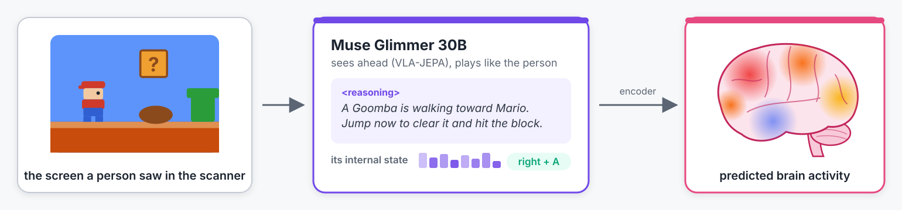
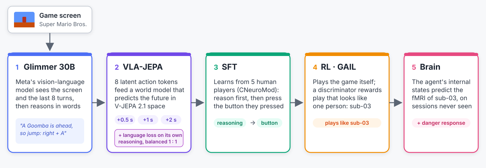

# Mario Mind

*An AI that plays like a person, thinks out loud, and predicts that person's brain activity.*



**Goal: an AI agent whose "mind" predicts a person's brain.** Muse Glimmer 30B learns to play *Super Mario Bros.*
the way a specific person does and says what it sees and why on every move. Its internal state, read through an
encoder fitted on that person's fMRI, predicts their brain activity scan by scan, on sessions it never saw. An agent
that plays like a person and predicts their brain is a **virtual participant**: hypotheses can be tested on its
generated brain data before paying for scanner time.

Built for the Meta Global AI Developer Hackathon (Oct 26 - Nov 4, 2026), theme *Push the Frontier*. Author: Ariana
Mondiri (Boston College). **Demo:** [the agent playing, its reasoning and the predicted brain](https://mondiriariana.github.io/arianamondiri/_site/project/2026-10-30-mario-agent/)
(the brain panel is a model prediction, not a measurement).

## How it works



1. **VLA-JEPA** (`experiments/glimmer_vlajepa`): Glimmer is fully fine-tuned to predict what happens next on screen,
   in the space of V-JEPA 2.1 (Meta's video model), 0.5 to 2 s ahead, with a language loss so it keeps reasoning.
2. **SFT** (`experiments/glimmer_imitation`): on 5 people's play, Glimmer first writes its own perception and
   reasoning for each moment (from the screens only), then learns to press the button the person pressed.
3. **RL** (`experiments/glimmer_imitation/rl.py`): the agent plays on its own, rewarded for playing like one person
   (GAIL), with a KL leash to the SFT model.
4. **Calibration** (`brain_pred/agent`): the agent watches the exact screens the person saw in the scanner; we record
   its internal state and the running context of what it has written.
5. **Brain encoder** (`brain_pred/encoding`): ridge regression from V-JEPA + the agent's state + its reply context to
   1,000 brain regions, fitted on training sessions and tested on held-out sessions. The generator and demo
   (`brain_pred/generator`, `brain_pred/demo`) apply it to the agent's own play.

Data: CNeuroMod's *Super Mario Bros.* dataset, 5 people with 20-30 fMRI sessions each, playing the real game in the
scanner with every button press recorded.

## Results

**The agent's mind adds to what is on screen** (sub-03, 19 held-out runs from 6 held-out sessions; gain in mean
correlation over a nuisance model of buttons, level, time, luminance, motion and sound; 1,000 regions; scans where
the agent's last decision is at most one scan old, 89% of them):

| Encoder | Gain | Regions better than V-JEPA |
|---|---|---|
| V-JEPA 2.1 alone (the strongest single feature) | +0.0581 | |
| V-JEPA + the agent's prompt state | +0.0617 | 350 |
| V-JEPA + the context of its replies | +0.0644 | 492 |
| **V-JEPA + the agent's state + the context of its replies** | **+0.0672** | **667** |
| Control: the same, with the reply context shifted in time | +0.0617 | |
| **After RL: V-JEPA + the agent's state + the context of its replies** | **+0.0688** | **721** |

Shifted in time, the reply context adds nothing (the gain falls back to what the state alone adds), so it is tied to the
moment. The gain is largest in the salience / ventral attention (+0.014), somatomotor (+0.013) and dorsal attention (+0.011)
networks, then control, visual and default mode; it is near zero in limbic regions. The first five rows are the agent after SFT; after RL (checkpoint after 10
iterations) the same encoder gains more, +0.0688, better than V-JEPA in 721 of 1,000 regions: playing more like the
person also makes its mind line up better with their brain.

**It plays like the person** (RL toward sub-03; matched moments = the same game situations; a classifier trained to
tell the agent's moves from the person's scores 0.5 when it cannot tell them apart):

| Agent | Classifier, agent vs sub-03 | Action KL vs sub-03 |
|---|---|---|
| After SFT (RL iteration 1) | 0.84 | 0.50 |
| **After RL (iterations 20-31)** | **0.49-0.56** | **~0.01** |

It reasons before every move (100% of replies) and stays close to the SFT model (KL ~0.01 per token).

**It has a sense of danger that lines up with the brain.** A linear readout of the risk of dying within 3 s from the
agent's state (layer 26) reaches r 0.60 on held-out scans (V-JEPA 0.70; buttons, level and low-level features 0.48); its readout agrees with
the brain's own danger readout over 88 danger-responsive regions (r 0.34, p 0.005) and predicts their activity
(r 0.098, vs 0.084 for the true danger signal).

Limits: one person and one held-out split for the brain; RL and the final agent are single runs. Every metric is
explained in [docs/METRICS.md](docs/METRICS.md).

## Meta models used

| Model | How |
|---|---|
| **Muse Glimmer 30B** (open weights) | Full fine-tune (VLA-JEPA, FSDP on 4 H200), LoRA SFT with its own reasoning, RL with a GAIL reward, served with vLLM for rollouts; its hidden states are the agent's "mind". All on our own hardware. |
| **V-JEPA 2.1 ViT-G** | Video features: the targets VLA-JEPA learns to predict, and a brain-encoding feature. |

## Repository

| Path | What |
|---|---|
| `experiments/glimmer_vlajepa/` | VLA-JEPA on Glimmer |
| `experiments/glimmer_imitation/` | play loop, SFT, RL, test against the person |
| `experiments/odysseus/` | Odysseus reasoning traces turned into SFT examples |
| `experiments/vjepa_spark_combo/` | the frame set VLA-JEPA trains on |
| `brain_pred/` | calibration, brain encoders, generator, demo, danger analysis ([README](brain_pred/README.md)) |
| `scripts/` | V-JEPA features, full game RAM, moment index ([README](scripts/README.md)) |
| `mjg/` | shared code: emulator, data index, V-JEPA loader, encoding helpers, LoRA |
| `slurm/`, `configs/` | cluster launchers, held-out sessions |
| `docs/` | data, metrics, figures |

## Reproduce

**Data (not in this repository):** CNeuroMod *mario* and *mario.fmriprep*, under CNeuroMod's data-use terms
(https://docs.cneuromod.ca); the game integration from
[courtois-neuromod/mario.stimuli](https://github.com/courtois-neuromod/mario.stimuli). Model weights: Muse Glimmer
30B, V-JEPA 2.1 ViT-G. **Compute:** 4x H200 (VLA-JEPA), 2-4x L40S (SFT, RL, calibration), CPU nodes (features,
encoders); paths in `slurm/paths.local.sh` (copy `slurm/paths.example.sh`). Held-out fMRI sessions are fixed in
`configs/holdout_sessions.json` and never used for training.

```bash
sbatch experiments/glimmer_vlajepa/job_long.sbatch                                # 1. VLA-JEPA (settings: long_run.sh)
sbatch --export=ALL,SFT_MODEL=<VLA-JEPA Glimmer> experiments/glimmer_imitation/job_sft.sbatch   # 2. SFT (sft.sh)
sbatch --export=ALL,RL_MODEL=<VLA-JEPA Glimmer>,RL_INIT=<SFT lora.pt>,RL_FORCE=1 \
       experiments/glimmer_imitation/job_rl.sbatch                                # 3. RL (settings: rl.sh)
# 4-5. calibration, brain encoder, generator, demo: brain_pred/README.md
```

## Built during the hackathon

Everything Glimmer (VLA-JEPA, SFT, RL, the play loop), the calibration, the brain encoders with the agent and its
reply context, the generator, the demo and the danger analysis were built during the hackathon (Oct 26 - Nov 4).
Reused from before: the emulator wrapper and data index (`mjg/emulator.py`, `mjg/data.py`, `mjg/objects.py`, Oct
21-24) and ridge / timing helpers from the author's earlier fMRI work (`mjg/encoding.py`).

## Credits

CNeuroMod (Courtois NeuroMod project) for the *mario* dataset and game integration; VLA-JEPA (arXiv 2602.10098) for
the world-model objective; Odysseus for the reasoning-trace format; Schaefer et al. 2018 for the brain atlas.
Related work: [brain_pred/LITERATURE.md](brain_pred/LITERATURE.md).
